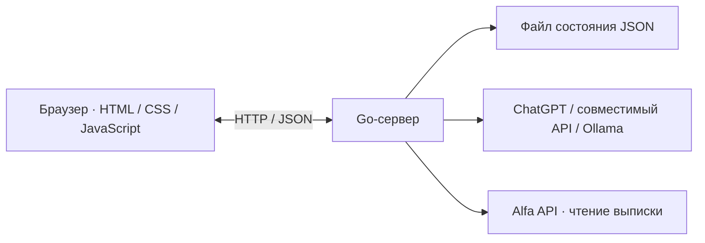

# Ритм

AI-помощник для управления финансами малого бизнеса на примере кофейни. Помогает учитывать выручку и расходы, планировать обязательства, оценивать денежный запас и обсуждать финансовые показатели с языковой моделью.

Проект разработан с использованием AI-инструментов. Интерфейс и сервер работают как одно приложение на Go.

## Возможности

- Ввод и изменение фактической выручки за день.
- Учёт дополнительных расходов с категориями и поиском.
- Изменение текущего остатка и ожидаемых ежедневных поступлений и расходов.
- Календарь обязательств с редактированием сумм и сроков.
- Отметка совершённых оплат без повторного списания в прогнозе.
- Прогноз денежных остатков на 14 дней и сравнение сценариев.
- Индекс здоровья бизнеса с предварительным пересчётом в формах.
- Аналитика за 7, 30 и 90 дней.
- Предварительный расчёт аванса УСН «Доходы».
- Встроенный AI-чат с финансовым контекстом.
- Импорт расходов и экспорт отчёта в CSV.
- Получение банковской выписки через адаптер Alfa API.
- Адаптивный интерфейс для компьютеров и мобильных устройств.

## Быстрый запуск

Потребуется **Go 1.25 или новее**.

```powershell
git clone https://github.com/scroolls/Ritm.git
cd Ritm
go run -buildvcs=false .
```

Откройте в браузере:

```text
http://127.0.0.1:8080
```

Node.js и установка зависимостей фронтенда для обычного запуска не требуются.

`go run` собирает и запускает приложение из текущей папки. Флаг `-buildvcs=false` отключает добавление сведений Git в сборку. Для остановки сервера нажмите `Ctrl+C`.

### Сборка исполняемого файла на Windows

```powershell
go build -buildvcs=false -o ritm.exe .
.\ritm.exe
```

Файлы интерфейса встраиваются в программу через `go:embed`. После изменения HTML, CSS или JavaScript приложение необходимо пересобрать.

## Архитектура



**Фронтенд** написан на HTML, CSS и JavaScript без React или Vue. Он управляет экранами, отправляет запросы через `fetch` и показывает предварительные изменения показателей.

**Бэкенд** использует стандартную библиотеку Go. Сервер проверяет входные данные, выполняет финансовые расчёты, сохраняет изменения и обращается к внешним сервисам.

**Хранение** организовано в JSON-файле. Записи защищены `sync.Mutex` внутри одного процесса. Сохранение выполняется через временный файл с последующей заменой предыдущего состояния.

Расчёты реализованы на Go и JavaScript; тесты проверяют их согласованность.

### Основные файлы

| Файл или папка | Назначение |
|---|---|
| `main.go` | HTTP-сервер, API, сохранение, CSV и встраивание интерфейса |
| `model.go` | История продаж, прогноз и сводные показатели |
| `finance.go` | Выручка, остаток, финансовый план, обязательства и индекс |
| `tax.go` | Предварительный налоговый расчёт |
| `chatgpt.go` | Авторизация ChatGPT, выбор модели и обработка ответов |
| `config.go` | Подключение совместимого API и Ollama |
| `bank.go` | Адаптер банковской выписки |
| `security.go` | Проверки доступа, адреса сайта и частоты запросов |
| `dist/` | Интерфейс и расчёты в браузере |
| `*_test.go` | Серверные тесты |
| `tests/ui.test.cjs` | Браузерные проверки |
| `.github/workflows/test.yml` | Автоматические проверки GitHub Actions |

## Логика финансового учёта

Изменение выручки заменяет данные выбранного дня. Остаток корректируется на разницу с предыдущим значением — повторное сохранение не дублирует поступления.

Прогноз строится из текущего остатка, ожидаемых поступлений, ежедневных расходов и неоплаченных обязательств на соответствующие даты.

Отметка оплаты уменьшает остаток сейчас и исключает тот же платёж из будущего списания. Перенесённое за пределы 14 дней обязательство остаётся в календаре, но не входит в ближайший прогноз.

Индекс здоровья бизнеса складывается из двух частей:

- **Запас денег — до 70 баллов:** учитываются минимальный и конечный остатки прогноза относительно текущих расходов.
- **Операционная маржа — до 30 баллов.**

Индекс пересчитывается после изменения данных. Выполнение пункта в списке рекомендаций само по себе не повышает оценку.

## AI-помощник

Настройка доступна в разделе **«AI-помощник» → «Настроить ИИ»**.

### ChatGPT

Официальный вход через **Continue with ChatGPT**, затем выбор доступной модели. Использование зависит от разрешений и лимитов аккаунта.

Авторизация реализована через OAuth с PKCE и проверкой токенов. История прежних разговоров пользователя в ChatGPT приложению не передаётся.

### OpenAI-совместимый API

Укажите адрес API, модель и ключ. Сервер выполнит короткую проверку подключения. Запросы оплачиваются по тарифам выбранного провайдера.

### Ollama

После установки Ollama загрузите локальную модель, например:

```powershell
ollama pull qwen2.5:3b
```

Выберите Ollama в настройках Ритма и укажите имя установленной модели. Адаптер обращается к `127.0.0.1:11434`.

Без подключения языковой модели доступен отдельно обозначенный разбор по правилам.

### Контекст и хранение ключей

Помощник получает вопрос и финансовую сводку: остаток, прогноз, обязательства, налоговый расчёт и последние расходы. Он возвращает рекомендации текстом и не выполняет финансовые операции.

Введённые через интерфейс ключи и токены хранятся в памяти сервера. После перезапуска потребуется восстановить подключение. API-ключ можно также задать локально через `.env`.

## Банковское подключение

Через **«Подключить счёт»** доступен адаптер Alfa API.

Потребуются номер счёта и доступ владельца к сервису `transactions`: API Key H2H или Bearer-токен.

Текущая реализация:

- запрашивает первую страницу выписки за выбранную дату;
- отображает её отдельно от финансового плана;
- обрабатывает суммы выписки в целых копейках;
- не отправляет банковские реквизиты и токен языковой модели;
- не создаёт платежи и не изменяет финансовый план автоматически.

Ритм — независимый проект, не продукт Альфа-Банка.

## Настройки

Если `.env` ещё не создан, скопируйте шаблон:

```powershell
Copy-Item .env.example .env
```

| Переменная | Назначение |
|---|---|
| `ADDR` | Адрес сервера, по умолчанию `127.0.0.1:8080` |
| `DATA_FILE` | Путь к состоянию, по умолчанию `data/state.json` |
| `AI_BASE_URL` | Адрес совместимого API |
| `AI_MODEL` | Идентификатор модели |
| `AI_API_KEY` | API-ключ |
| `AI_PROVIDER` | `api` или `ollama` |
| `APP_USER` | Имя владельца для HTTP-аутентификации |
| `APP_PASSWORD` | Пароль владельца |
| `PUBLIC_HOST` | Разрешённое имя хоста при внешнем размещении |

Переменные окружения имеют приоритет над `.env`.

Рабочие данные, `.env`, исполняемые файлы и зависимости тестов исключены через `.gitignore`. В `.env.example` следует оставлять только шаблон без секретов.

## Тестирование

### Серверная часть

```powershell
go test -cover ./...
go vet ./...
```

Проверяются финансовые расчёты, сохранение, 40 параллельных записей, импорт, валидация, авторизация и адаптеры внешних сервисов.

Результат последней локальной проверки: **34 серверных теста**, покрытие — **76,2%**.

### Интерфейс

Потребуются Node.js и npm. Используйте чистую копию проекта без `.env` и подключённых моделей: тесты сбрасывают данные и не рассчитаны на вход с паролем.

В первом окне PowerShell:

```powershell
$env:ADDR="127.0.0.1:8081"
$env:DATA_FILE="data/ui-test-state.json"
go run -buildvcs=false .
```

Во втором окне, из той же папки:

```powershell
npm install
npx playwright install chromium
$env:BASE_URL="http://127.0.0.1:8081"
npm run test:ui
```

Playwright проверяет формы, изменение показателей, сохранение, CSV, чат и мобильные размеры.

Результат последней локальной проверки: **26 успешных браузерных сценариев**.

В GitHub Actions настроены проверки Go и интерфейса. Детектор гонок `-race` включён в Linux CI; локально он не запускался из-за отсутствия CGO.

## Docker

Подготовлены `Dockerfile` и `compose.yaml`.

Перед запуском создайте `.env` и задайте `APP_USER` и `APP_PASSWORD` длиной не менее 16 символов.

```powershell
docker compose up --build -d
```

Просмотр журнала:

```powershell
docker compose logs -f
```

Остановка:

```powershell
docker compose down
```

Данные сохраняются в томе `pulse-data`. Порт контейнера опубликован только на `127.0.0.1:8080`.

## Текущие границы реализации

- Версия рассчитана на одного владельца и файловое хранение данных.
- Исходная история кофейни привязана к **27 октября 2026 года** и не является банковской выпиской.
- Прогноз и индекс рассчитываются по правилам приложения, без обученной ML-модели.
- Налоговый модуль реализует ограниченный предварительный расчёт, а не полноценную бухгалтерию.
- Живой ответ AI проверен через ChatGPT. Банковский адаптер проверен тестовыми ответами; подключение к реальному счёту не выполнялось.
- Docker-конфигурация подготовлена, локальная сборка контейнера отдельно не проверялась.
- Для многопользовательского размещения понадобятся отдельные аккаунты, изоляция данных, постоянная база, резервное копирование и HTTPS.
- Локальная авторизация ChatGPT требует отдельной схемы при переносе приложения на удалённый сервер.
